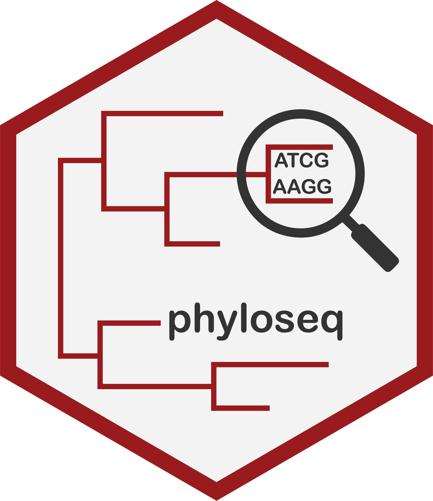

<link href="http://joey711.github.com/phyloseq/markdown.css" rel="stylesheet"></link>

# [phyloseq](http://joey711.github.com/phyloseq/)

This is **phyloseqV2**, a development fork of phyloseq. The R package is still
named `phyloseq`. See [DEVELOPMENT.md](DEVELOPMENT.md) for the source layout,
local test commands and the roadmap for transformations, normalization and
contaminant handling. The installation instructions below refer to the upstream
Bioconductor release.

The fork now includes a [compositional workflow](docs/compositional-workflow.md)
with prevalence filtering, TreeSummarizedExperiment conversion, explicit zero
handling, relative/Hellinger/CLR assays, validation, Aitchison distances and
QC/ordination plots.
Optional [microViz, tidyplots and pheatmap integrations](docs/plot-integrations.md)
add editable stacked bars, annotated clustered heatmaps and a microViz adapter.
The [targeted 16S ASV/SILVA workflow](docs/asv-silva-workflow.md) adds sequence
selection, versioned bacterial/archaeal reference QC and joint ML trees with
observed fragments. Backbone placement remains a planned extension.
The [change list and performance measurements](docs/changes-and-performance.md)
summarize the local refactoring, additions and measured optimizations.

[](https://github.com/l-gallucci/phyloseqV2/actions/workflows/tests.yaml)



## Quick Install

In R terminal:

```
if(!requireNamespace("BiocManager")){
  install.packages("BiocManager")
}
BiocManager::install("phyloseq")
```

See [the phyloseq installation page](http://joey711.github.io/phyloseq/install.html)
for further details, examples.

## Article on Improved Microbiome Analysis

McMurdie and Holmes (2014)
[Waste Not, Want Not: Why Rarefying Microbiome Data is Statistically Inadmissible](http://dx.plos.org/10.1371/journal.pcbi.1003531)
*PLoS Computational Biology*
10(4): e1003531

Presubmission versions ahead of acceptance (2013):
[PDF version 2](http://arxiv.org/pdf/1310.0424v2.pdf),
[PDF version 1](http://arxiv.org/pdf/1310.0424v1.pdf)


## Peer-reviewed articles about phyloseq

McMurdie and Holmes (2014) [Shiny-phyloseq: Web Application for Interactive Microbiome Analysis with Provenance Tracking](http://bioinformatics.oxfordjournals.org/content/early/2014/10/02/bioinformatics.btu616).
*Bioinformatics (Oxford, England)*
31(2), 282–283.

McMurdie and Holmes (2013)
[phyloseq: An R package for reproducible interactive analysis and graphics of microbiome census data](http://dx.plos.org/10.1371/journal.pone.0061217)
*PLoS ONE* 
8(4):e61217

## Other resources

The phyloseq project also has a number of supporting online resources,
including (but probably not limited to)

### [the phyloseq home page](http://joey711.github.com/phyloseq/)

### [the phyloseq FAQ](https://www.bioconductor.org/packages/release/bioc/vignettes/phyloseq/inst/doc/phyloseq-FAQ.html)
I recommend checking this page, and the issues tracker,
before posting new issues.

### [Bioconductor stable release](http://bioconductor.org/packages/release/bioc/html/phyloseq.html).

### [the phyloseq Issue Tracker](https://github.com/joey711/phyloseq/issues)
This is the recommended location to post

(1) feature requests
(2) bug reports
(3) theoretical considerations
(4) other issues, feedback
(5) ask for help

Search previous posts,
and check [the phyloseq FAQ](https://www.bioconductor.org/packages/release/bioc/vignettes/phyloseq/inst/doc/phyloseq-FAQ.html)
before posting a new issue.

Thank you for your interest.
